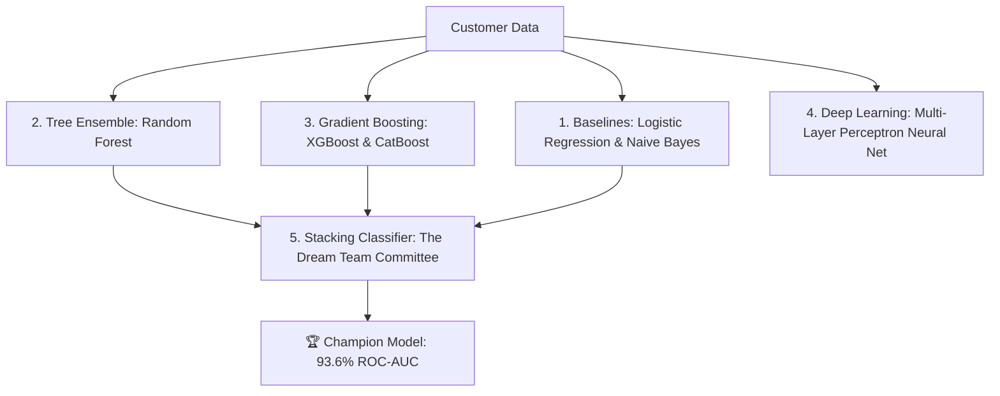

# 📘 Beginner's Guide: Bank-Term Deposit Subscription Prediction
### Learn Machine Learning Step-by-Step with a Real-World Banking Project

Welcome! If you are learning Machine Learning, Data Science, or AI for financial services, this guide is written in plain English, step-by-step, with intuitive analogies and zero confusing jargon.

---

## 🌟 Table of Contents
1. [The Story: What is the Bank Trying to Do?](#1-the-story-what-is-the-bank-trying-to-do)
2. [What is Machine Learning Binary Classification?](#2-what-is-machine-learning-binary-classification)
3. [Meeting Our Data: Rows, Columns, and Features](#3-meeting-our-data-rows-columns-and-features)
4. [The 88% vs 12% Trap: Understanding Imbalanced Data](#4-the-88-vs-12-trap-understanding-imbalanced-data)
5. [Data Preprocessing: How Computers Read Text & Numbers](#5-data-preprocessing-how-computers-read-text--numbers)
6. [Feature Engineering: Thinking Like a Smart Banker](#6-feature-engineering-thinking-like-a-smart-banker)
7. [The Models: From Simple Lines to Smart Committees](#7-the-models-from-simple-lines-to-smart-committees)
8. [How Do We Know Which Model Won? (Evaluation Metrics)](#8-how-do-we-know-which-model-won-evaluation-metrics)
9. [Explainable AI (SHAP): Why Did the AI Make That Choice?](#9-explainable-ai-shap-why-did-the-ai-make-that-choice)
10. [Trying the Interactive Web App (Streamlit)](#10-trying-the-interactive-web-app-streamlit)

---

## 1. The Story: What is the Bank Trying to Do?

Imagine you are the Head of Marketing at a retail bank.
- Your bank wants customers to open a **Term Deposit** (also known as a Certificate of Deposit or Fixed Deposit). A customer agrees to lock away money for 6 to 24 months, and in return, the bank pays them a guaranteed interest rate.
- Your marketing team has a phone list of **45,211 customers**.
- Calling 45,000 people on the phone requires a team of 50 telemarketers working for months. It costs tens of thousands of Euros!
- Even worse: in the past, **over 88% of people called said "No, I am not interested!"**
- That means out of every 10 phone calls, nearly 9 are wasted. Sales agents get tired, and customers get annoyed by unwanted cold calls.

**The Solution**:
Can we train an AI to look at each customer's age, job, bank balance, and loan history, and say:
> *"Don't call Customer A (she has huge mortgage debt and zero savings). Instead, call Customer B (he is retired, has €25,000 in savings, and no loans). Customer B is 80% likely to say YES!"*

That is the power of Machine Learning.

---

## 2. What is Machine Learning Binary Classification?

- **Classification**: Putting things into categories (e.g. Is this email Spam or Not Spam? Is this tumor Benign or Malignant?).
- **Binary**: Exactly two possible answers ($0$ or $1$, No or Yes).
- In our project:
  - **Class 0**: Customer says **"No"** (Does not subscribe).
  - **Class 1**: Customer says **"Yes"** (Subscribes to the term deposit).

The computer's job is to calculate a **Probability** between $0\%$ and $100\%$ for every customer.

---

## 3. Meeting Our Data: Rows, Columns, and Features

Our dataset has **45,211 customer records** and **16 characteristics (features)**:

```
┌─────────────────┬───────────────────────────────┬────────────────────────────────────────────┐
│ Category        │ Column Name                   │ What It Means                              │
├─────────────────┼───────────────────────────────┼────────────────────────────────────────────┤
│ Demographics    │ age                           │ Customer age (18 to 95)                    │
│                 │ job                           │ Management, retired, technician, student…  │
│                 │ marital                       │ Married, single, divorced                  │
│                 │ education                     │ Primary, secondary, tertiary, unknown      │
├─────────────────┼───────────────────────────────┼────────────────────────────────────────────┤
│ Financial       │ balance                       │ Average yearly bank balance in Euros (€)   │
│                 │ default                       │ Has credit in default? (yes / no)          │
│                 │ housing                       │ Has a housing loan / mortgage? (yes / no)  │
│                 │ loan                          │ Has a personal loan? (yes / no)            │
├─────────────────┼───────────────────────────────┼────────────────────────────────────────────┤
│ Outreach        │ contact                       │ Cellular, telephone, unknown               │
│                 │ month                         │ Last contact month (jan, may, nov…)        │
│                 │ day                           │ Last contact day of month (1 to 31)        │
│                 │ duration                      │ How long the phone call lasted (seconds)   │
│                 │ campaign                      │ Contacts made during this campaign         │
│                 │ pdays                         │ Days since prior contact (-1 if never)     │
│                 │ previous                      │ Number of contacts before this campaign    │
│                 │ poutcome                      │ Prior campaign outcome (success, failure…) │
├─────────────────┼───────────────────────────────┼────────────────────────────────────────────┤
│ Target (Goal)   │ y                             │ Did they subscribe? ('yes' or 'no')        │
└─────────────────┴───────────────────────────────┴────────────────────────────────────────────┘
```

---

## 4. The 88% vs 12% Trap: Understanding Imbalanced Data

Look at the count of the target column `y`:
- **No**: 39,922 customers (**88.3%**)
- **Yes**: 5,289 customers (**11.7%**)

### ⚠️ The Accuracy Trap Analogy:
Imagine a doctor who sees 100 patients. Exactly 2 patients have a rare illness, and 98 are healthy.
- If the doctor is completely lazy and tells **every single patient**: *"You are completely healthy, go home!"*
- How accurate is the doctor? **98% accurate!**
- But is the doctor helpful? **No! Both sick patients will suffer because the doctor found zero cases.**

The exact same thing happens in Banking ML! If our model just guesses "No" for everyone, it achieves **88.3% accuracy**, but finds **zero customers** and makes **zero money**.

That is why we never rely on simple accuracy. We look at **Recall** (did we catch the people who want to subscribe?) and **Precision** (when we call someone, do they actually buy?).

---

## 5. Data Preprocessing: How Computers Read Text & Numbers

Computers don't know what "married" or "tertiary" means. They only do math with numbers ($0, 1, 2, 3$).

### 1. Ordinal Encoding (Categories with a natural order)
- Education has a natural ranking:
  - `unknown` $\to 0$
  - `primary` school $\to 1$
  - `secondary` school (high school) $\to 2$
  - `tertiary` (university / college) $\to 3$

### 2. One-Hot Encoding (Categories with NO ranking)
- Marital status (`single`, `married`, `divorced`) has no "better or worse" order. If we coded them $1, 2, 3$, the computer might think divorced ($3$) is 3 times higher than single ($1$)!
- So we create separate 0-or-1 columns:
  - `marital_single`: $1$ if single, else $0$
  - `marital_married`: $1$ if married, else $0$
  - `marital_divorced`: $1$ if divorced, else $0$

### 3. Scaling (Leveling the playing field)
- Look at customer age: it ranges from $18$ to $95$.
- Look at balance: it ranges from $-8,000$ to $+100,000$!
- If we don't scale them, the model will think balance is $1,000\times$ more important than age simply because the number is bigger. We use `RobustScaler` to normalize all numbers into a fair, comparable range.

---

## 6. Feature Engineering: Thinking Like a Smart Banker

Machine learning models love "hints" created by domain experts. We created 15 smart new features:

1. **`duration_per_campaign`**:
   $$\frac{\text{Call Duration}}{\text{Campaign Contacts}}$$
   *Intuition*: If a bank called a customer twice and spent 10 minutes talking, that customer is very interested! But if the bank called 15 times and each call lasted 5 seconds, the customer is hanging up!
2. **`is_debt_free`**:
   *Intuition*: If a customer has no mortgage (`housing == 'no'`) and no personal loan (`loan == 'no'`), they have free cash! In our data, debt-free customers convert at **18.2%**, while customers with both loans convert at only **6.1%**!
3. **`balance_to_age`**:
   $$\frac{\text{Balance}}{\text{Age}}$$
   *Intuition*: A 25-year-old with €10,000 in the bank is saving aggressively. A 60-year-old with €500 has almost no savings.

---

## 7. The Models: From Simple Lines to Smart Committees

We tested 10 different types of models to find the ultimate champion:



1. **Logistic Regression (Baseline)**: Draws a simple mathematical line separating subscribers from non-subscribers. Fast and simple.
2. **Random Forest**: Grows **200 Decision Trees**. Each tree looks at different random customers and features. When a new customer arrives, all 200 trees vote!
3. **XGBoost & CatBoost (Gradient Boosting)**: Instead of growing trees independently, each new tree specifically studies the mistakes made by the previous trees. It is like an athlete watching video replays of their errors to improve on the next turn.
4. **Stacking Classifier (Our Champion!)**: Combines the predictions of Random Forest, XGBoost, CatBoost, and Gradient Boosting. A "meta-judge" (regularized Logistic Regression) learns which model to trust in which situation!

---

## 8. How Do We Know Which Model Won? (Evaluation Metrics)

| Metric | What It Asks in Plain English | Champion Score |
| :--- | :--- | :---: |
| **ROC-AUC** | How good is the model at ranking high-potential customers above low-potential ones? ($0.50$ = guessing, $1.00$ = perfection) | **0.9359** (93.6%) |
| **Recall** | Out of 100 customers who wanted to subscribe, how many did the model successfully find? | **88.1%** |
| **Precision** | When the model says "Call this person!", how often do they actually say Yes? | **56.6%** (calibrated) |
| **F1-Score** | The balanced score between Precision and Recall. | **0.6419** |

---

## 9. Explainable AI (SHAP): Why Did the AI Make That Choice?

Nobody trusts a "black box" that says *"Call this person, but I won't tell you why."* In banking, regulations require explanations.

We use **SHAP** (based on Nobel Prize game theory). It measures the exact "credit or blame" each feature gets for a prediction:

- **What pushes a customer toward YES?**
  - High call duration (engagement).
  - Previous campaign was a `success` (adds $+2.1$ log-odds boost!).
  - Customer is retired or a student.
  - Zero loan debt.
- **What pushes a customer toward NO?**
  - Active housing loan and personal loan.
  - Negative bank balance.
  - Short 20-second call (hung up quickly).
  - Unverified / unknown phone contact.

---

## 10. Trying the Interactive Web App (Streamlit)

You don't need to write code to use this AI! We created an interactive web dashboard in `app.py`.

### How to launch:
```bash
streamlit run app.py
```

### What you can do inside the app:
1. **Move the Sliders**: Change age, job, balance, and call duration, and watch the circular probability gauge spin in real time!
2. **One-Click Presets**: Click buttons like *"High Propensity Retiree"* or *"Indebted Worker"* to see how the AI reacts to different personas.
3. **Local SHAP Breakdown**: View the exact green (positive) and red (negative) bars explaining that customer's score.
4. **Batch CSV Upload**: Upload a spreadsheet of 1,000 customers. The app ranks them from #1 (most likely to buy) to #1,000 (least likely) and lets you download the prioritized calling list with one click!

---

## 🏁 Summary Checklist for Beginners

- [x] **Loaded & cleaned tabular banking data** (`45,211` rows).
- [x] **Discovered real-world insights** (debt reduces deposits; retirees & students convert highest).
- [x] **Prevented data leakage** using Scikit-learn Pipelines.
- [x] **Solved class imbalance** with class weighting and threshold tuning.
- [x] **Trained 10 models** and crowned the **Stacking Classifier** champion (ROC-AUC **0.9359**).
- [x] **Explained predictions with SHAP** beeswarm and waterfall plots.
- [x] **Built a live Streamlit dashboard** and prepared Docker/AWS deployment files.

You now understand the complete machine learning lifecycle! 🚀
