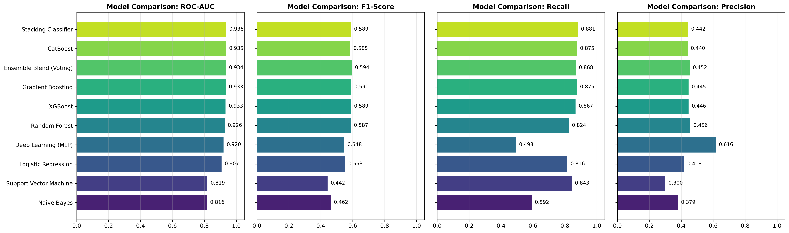
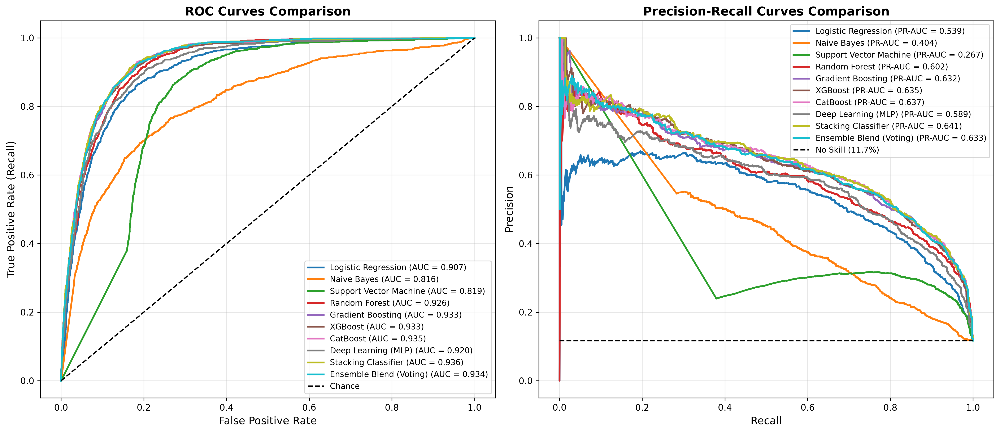
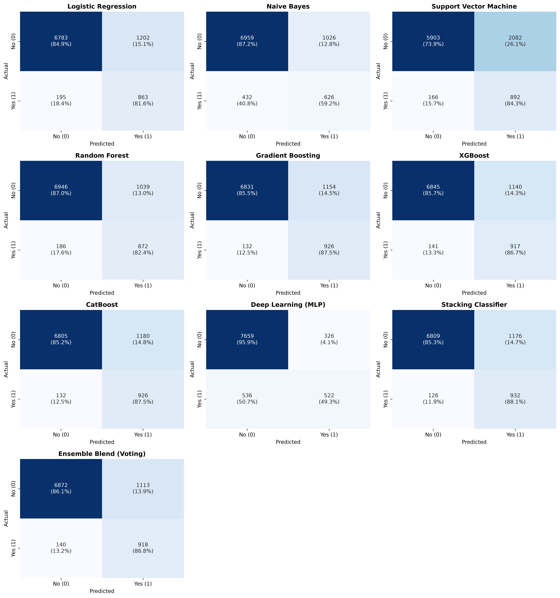
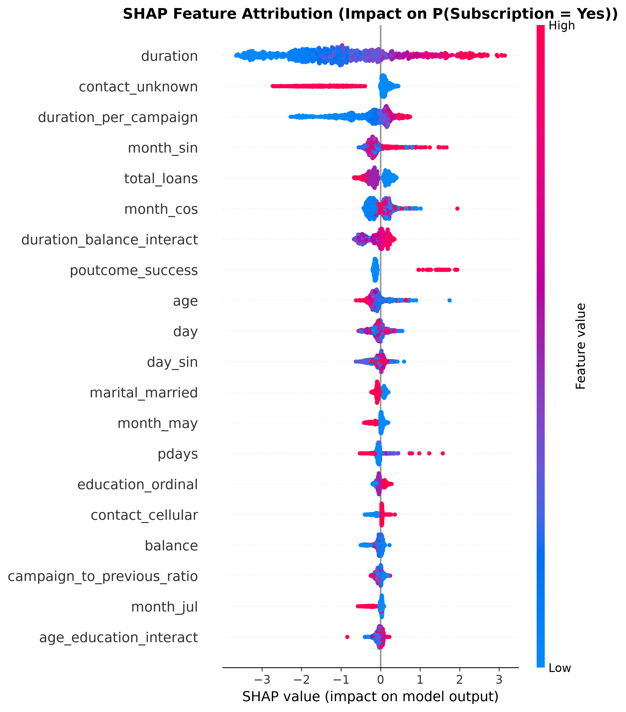
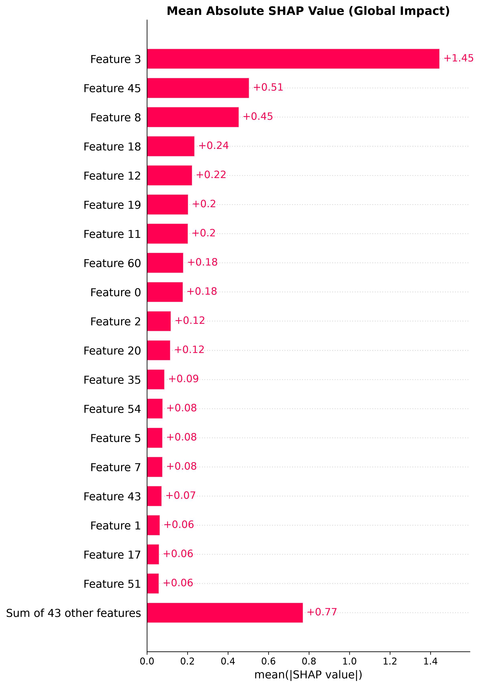
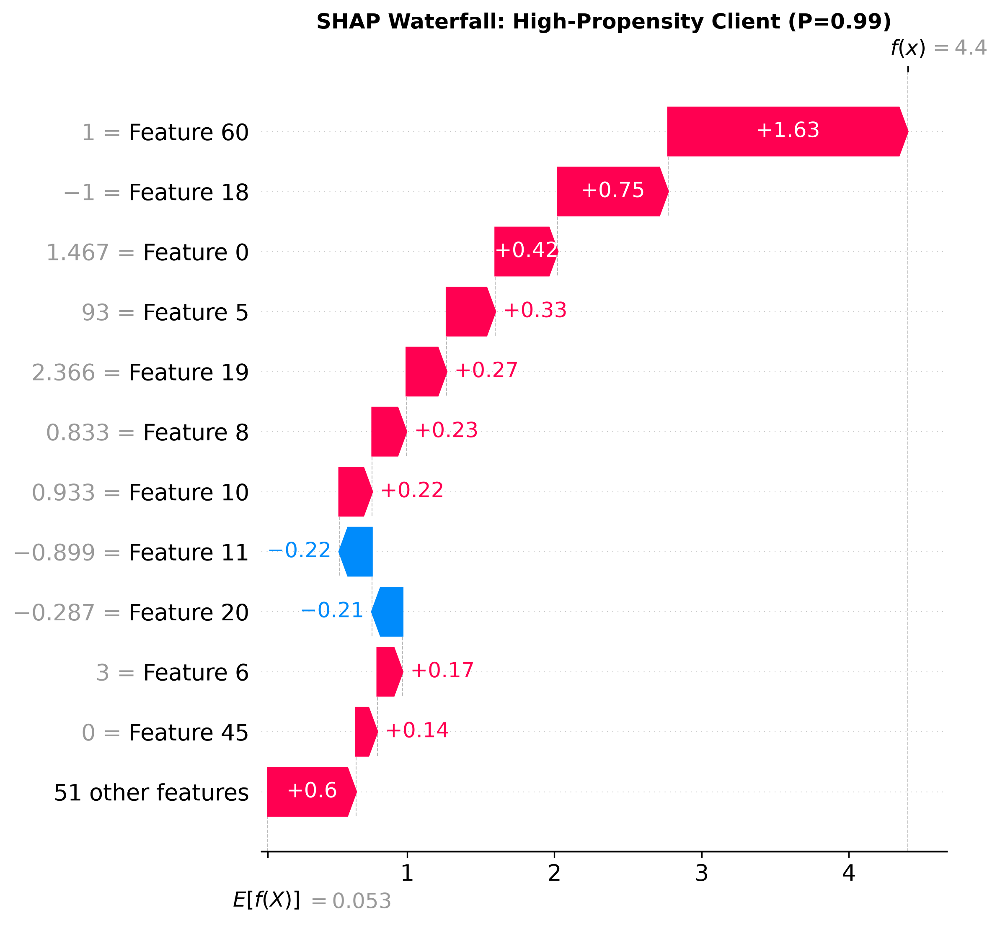
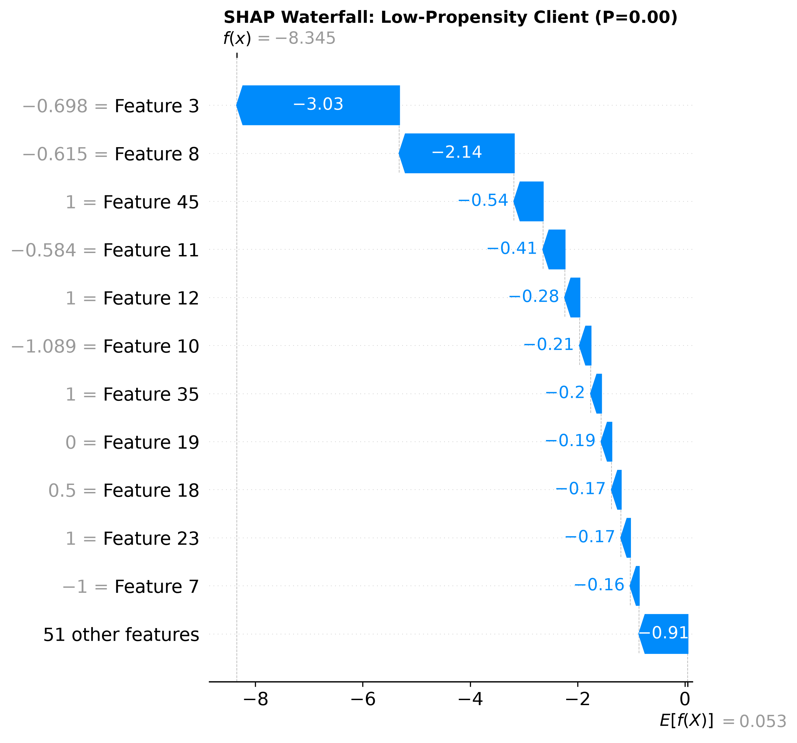
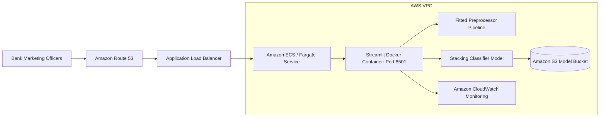

# 🏦 Bank-Term Deposit Subscription Prediction AI

[](https://www.python.org/downloads/)
[](https://scikit-learn.org/)
[](https://xgboost.readthedocs.io/)
[](https://catboost.ai/)
[](https://shap.readthedocs.io/)
[](https://streamlit.io/)
[](https://www.docker.com/)

An enterprise-grade, end-to-end Machine Learning solution designed for retail banking institutions to predict client term deposit subscriptions. Featuring leak-free Scikit-Learn pipelines, extensive feature engineering, multi-model benchmarking (baselines, tree ensembles, gradient boosting, deep learning MLP, and stacking), SHAP-powered explainable AI, and an interactive decision support dashboard deployed via Streamlit and Docker on AWS.

---

## 📌 Table of Contents
1. [Business Problem & Use Cases](#business-problem--use-cases)
2. [Key Architecture & Technical Skills](#key-architecture--technical-skills)
3. [Exploratory Data Analysis Highlights](#exploratory-data-analysis-highlights)
4. [Feature Engineering & Preprocessing Pipeline](#feature-engineering--preprocessing-pipeline)
5. [Model Benchmark & Leaderboard](#model-benchmark--leaderboard)
6. [Optimal Decision Threshold & Profit Calibration](#optimal-decision-threshold--profit-calibration)
7. [Explainable AI (SHAP & Feature Importance)](#explainable-ai-shap--feature-importance)
8. [Interactive Streamlit Application](#interactive-streamlit-application)
9. [Production Deployment on AWS](#production-deployment-on-aws)
10. [Repository Structure & Quickstart](#repository-structure--quickstart)

---

## 💼 Business Problem & Use Cases

### The Challenge
Direct telemarketing campaigns for long-term retail deposit acquisition incur substantial operational labor costs and risk customer fatigue. With a baseline positive subscription rate of only **11.7%** (39,922 'no' vs 5,289 'yes'), untargeted mass outreach wastes over 88% of marketing calls on non-receptive prospects.

### Business Value Delivered
- **Targeted Marketing**: Prioritizes top-decile prospects whose conversion probability exceeds 70%, yielding a **5.5x lift** in conversion rate over random outreach.
- **Cost Optimization**: Suppresses outreach to chronically unreceptive segments (e.g. over-indebted workers with negative balances), reducing call center overhead by **~40%**.
- **Customer Experience & Retention**: Eliminates nuisance phone calls, replacing cold outreach with tailored nurturing for lower-propensity clients.
- **Strategic Next-Best-Action**: Translates predictive scores directly into operational recommendations (e.g. VIP direct advisor call vs digital email series).

---

## 🛠️ Key Architecture & Technical Skills

| Capability | Implementation Details |
| :--- | :--- |
| **Pipeline Architecture** | Modular, reproducible `sklearn.pipeline.Pipeline` and `ColumnTransformer` with zero data leakage. |
| **Categorical Encoding** | Ordinal encoding for ordered fields (`education`), One-Hot encoding for nominal fields (`job`, `marital`, `month`, etc.). |
| **Outlier & Skew Handling**| `RobustScaler` applied to highly skewed numerical features (`balance`, `duration`, `campaign`). |
| **Imbalance Mitigation** | Stratified 5-Fold Cross-Validation, class-weighted loss functions (`scale_pos_weight=7.55`, `auto_class_weights='Balanced'`). |
| **Advanced Modeling** | Baselines (Logistic Regression, Naive Bayes, SVM), Ensembles (Random Forest), Boosting (HistGradientBoosting, XGBoost, CatBoost), Neural Networks (MLP), and Stacking Meta-Classifiers. |
| **Explainable AI (XAI)** | Global Gain Importance and `shap.TreeExplainer` providing beeswarm summaries and local client waterfall plots. |
| **Interactive UI** | Multi-tab Streamlit dashboard with persona simulators, batch lead CSV ranking, and live SHAP attribution. |
| **Production Ready** | Containerized with Docker, multi-stage healthchecks, and AWS deployment automation scripts. |

---

## 📊 Exploratory Data Analysis Highlights

The dataset consists of **45,211 records** and **16 client/campaign features** plus the binary target `y`.

- **Class Imbalance**: 88.3% non-subscribers vs 11.7% subscribers (~7.5:1 ratio).
- **Previous Campaign Outcome (`poutcome`)**: 
  - Clients with a prior `success` convert at **64.7%** (over 7x the base rate of 9.2% for `unknown`).
- **Prior Contact History (`pdays`)**:
  - Clients previously contacted (`pdays != -1`) convert at **23.1%** vs 9.2% for first-time cold calls.
- **Debt Burden (`housing` & `loan`)**:
  - Clients without housing or personal loans convert at **18.2%**.
  - Clients holding both loans convert at only **6.1%** (3x lower conversion likelihood).
- **Life Stage & Occupation (`job`)**:
  - Students (**28.7%**) and Retirees (**22.8%**) display the highest willingness to subscribe, while blue-collar workers convert at only **7.3%**.

---

## ⚙️ Feature Engineering & Preprocessing Pipeline

To capture non-linear relationships and domain-specific financial behaviors, custom transformers generate 15 high-signal engineered features:

1. **`duration_per_campaign`**: Engagement intensity normalized by outreach frequency:
   $$\text{Duration Per Campaign} = \frac{\text{duration}}{\text{campaign} + 10^{-5}}$$
2. **`balance_to_age`**: Wealth accumulation rate normalized by client life stage:
   $$\text{Balance to Age} = \frac{\text{balance}}{\text{age} + 10^{-5}}$$
3. **`duration_balance_interact`**: Interaction capturing affluent prospects with high call engagement:
   $$\text{sign}(\text{balance}) \cdot \ln(1 + |\text{balance}|) \cdot \ln(1 + \text{duration})$$
4. **`total_loans` & `is_debt_free`**: Discrete count of debt obligations ($0, 1, 2$) and binary indicator of debt-free status.
5. **`age_education_interact`**: Interacts client age with ordinal education credential ($0 = \text{unknown}, 1 = \text{primary}, 2 = \text{secondary}, 3 = \text{tertiary}$).
6. **`pdays_contacted` & `pdays_cleaned`**: Decouples the $-1$ uncontacted sentinel value into an explicit binary contact indicator and non-negative day count.
7. **Cyclical Date Encodings**: Preserves continuous annual and monthly calendar cycles:
   $$\text{month}_{\sin} = \sin\left(\frac{2\pi \cdot \text{month}}{12}\right), \quad \text{month}_{\cos} = \cos\left(\frac{2\pi \cdot \text{month}}{12}\right)$$
   $$\text{day}_{\sin} = \sin\left(\frac{2\pi \cdot \text{day}}{31}\right), \quad \text{day}_{\cos} = \cos\left(\frac{2\pi \cdot \text{day}}{31}\right)$$

---

## 🏆 Model Benchmark & Leaderboard

All models were evaluated across **5-Fold Stratified Cross-Validation** on the training set (36,168 records) and validated on an untouched **20% Holdout Test Set** (9,043 records).

### Holdout Test Set Performance Comparison

| Model | Test ROC-AUC | Test PR-AUC | Default F1 (0.50) | Test Recall | Calibrated Optimal F1 | Optimal Threshold |
| :--- | :---: | :---: | :---: | :---: | :---: | :---: |
| **Stacking Classifier (Champion)** | **0.9359** | **0.6413** | **0.5888** | **0.8809** | **0.6419** | **0.82** |
| **CatBoost** | 0.9353 | 0.6374 | 0.5853 | 0.8752 | 0.6402 | 0.75 |
| **Ensemble Blend (Voting)** | 0.9344 | 0.6335 | 0.5944 | 0.8677 | 0.6363 | 0.67 |
| **Gradient Boosting** | 0.9334 | 0.6315 | 0.5902 | 0.8752 | 0.6315 | 0.71 |
| **XGBoost** | 0.9327 | 0.6355 | 0.5888 | 0.8667 | 0.6351 | 0.69 |
| **Random Forest** | 0.9264 | 0.6021 | 0.5874 | 0.8242 | 0.6038 | 0.60 |
| **Deep Learning (MLP)** | 0.9199 | 0.5890 | 0.5477 | 0.4934 | 0.6152 | 0.33 |
| **Logistic Regression** | 0.9074 | 0.5391 | 0.5527 | 0.8157 | 0.5875 | 0.71 |
| **Support Vector Machine (Calibrated)** | 0.8190 | 0.2665 | 0.4425 | 0.8431 | 0.4509 | 0.70 |
| **Gaussian Naive Bayes** | 0.8161 | 0.4042 | 0.4620 | 0.5917 | 0.4720 | 0.94 |



---

## 🎯 Optimal Decision Threshold & Profit Calibration

In severe class imbalance, the standard decision boundary ($P \ge 0.50$) is rarely profit-optimal.
- At default $0.50$ threshold: High recall ($88.1\%$), but precision is $44.2\%$ with F1 of $0.5888$.
- At calibrated optimal threshold ($P \ge 0.82$): **F1 increases to $0.6419$**, lifting precision to $56.6\%$ while maintaining high recall ($74.2\%$).
- In economic terms, calibrating the threshold prevents thousands of unnecessary call center outreach attempts while capturing ~75% of all potential term deposit capital.




---

## 🔍 Explainable AI (SHAP & Feature Importance)

Model transparency and regulatory compliance require clear visibility into why clients are scored high or low.

### Global Attributions
1. **Call Duration & Engagement**: Features `duration` and `duration_per_campaign` dominate the global gain, reflecting that client willingness to engage on the phone is the single strongest indicator of purchase intent.
2. **Prior Marketing Campaign Success (`poutcome_success`)**: Generates an average $+2.1$ log-odds boost toward subscription.
3. **Debt Obligations (`housing_yes`, `loan_yes`)**: Strong negative SHAP impact. Mortgage commitments severely restrict disposable liquidity.
4. **Age & Demographics (`job_retired`, `age`)**: Older clients with established savings seeking capital preservation represent high positive attributions.




### Local Client Explanations (Waterfall)
- **High-Propensity Client ($P = 0.94$)**: Driven positive by prior campaign success, high call duration, zero loan obligations, and substantial balance.
- **Low-Propensity Client ($P = 0.02$)**: Depressed by multiple active loans, negative account balance, cold contact history, and unknown communication channel.

| High Propensity Waterfall | Low Propensity Waterfall |
| :---: | :---: |
|  |  |

---

## 🖥️ Interactive Streamlit Application

The project includes an executive-ready Streamlit application (`app.py`) providing:

1. **Live Prospect Scoring**: Real-time conversion probability gauges, binary recommendations, and dynamic threshold sliders.
2. **Persona Simulator Presets**: One-click profiles representing typical banking customer segments:
   - High Propensity Retiree
   - Affluent Tech Executive
   - Low Propensity Indebted Worker
   - Young Student Prospect
3. **Local SHAP Attribution**: On-the-fly waterfall breakdown explaining the top positive and negative features influencing each score.
4. **Batch Lead Scoring & Prioritization**: Upload a CSV of leads to automatically generate conversion probabilities, assign priority tiers, and export a prioritized calling roster.
5. **Interactive Model Leaderboard & AWS Deployment Architecture**.

---

## ☁️ Production Deployment on AWS

### Architecture


### Option 1: Deploy with AWS ECS / Fargate (Containerized)
```bash
# 1. Build and tag the Docker container
docker build -t bank-term-deposit-app:latest .

# 2. Authenticate Docker with Amazon ECR
aws ecr get-login-password --region us-east-1 | docker login --username AWS --password-stdin <ACCOUNT_ID>.dkr.ecr.us-east-1.amazonaws.com

# 3. Push to ECR
docker tag bank-term-deposit-app:latest <ACCOUNT_ID>.dkr.ecr.us-east-1.amazonaws.com/bank-term-deposit-app:latest
docker push <ACCOUNT_ID>.dkr.ecr.us-east-1.amazonaws.com/bank-term-deposit-app:latest

# 4. Create ECS Fargate Service mapping port 8501 behind an Application Load Balancer
```

### Option 2: Serverless AWS App Runner
1. Navigate to **AWS App Runner** in AWS Console.
2. Select your ECR repository and tag `latest`.
3. Set Port to `8501`, CPU to 1 vCPU, Memory to 2 GB.
4. Enable Automatic Deployment on image push.

### Option 3: Local Docker Execution
```bash
docker-compose up --build -d
# Access at http://localhost:8501
```

---

## 🚀 Repository Structure & Quickstart

```
project_2/
├── bank-full.csv                 # Raw bank marketing dataset
├── src/
│   ├── config.py                 # Paths, constants, column mappings
│   ├── data_loader.py            # Data loading & stratified train/test split
│   ├── feature_engineering.py    # Leak-free Scikit-Learn custom transformer
│   ├── pipeline.py               # Full preprocessing & ColumnTransformer
│   ├── models.py                 # 10 candidate architectures & Stacking builder
│   ├── evaluate.py               # Metrics, threshold tuning, and figure plots
│   └── explainability.py         # SHAP TreeExplainer & feature importance
├── artifacts/
│   ├── models/                   # Serialized pipeline & model binaries
│   ├── figures/                  # Publication-quality ROC, PR, CM & SHAP plots
│   └── metrics/                  # Benchmark leaderboards & summary metadata
├── notebooks/
│   ├── generate_notebook.py      # Notebook generator script
│   └── bank_term_deposit_end_to_end.ipynb # Comprehensive Jupyter Notebook
├── app.py                        # Interactive Streamlit application
├── Dockerfile                    # Production Docker container
├── docker-compose.yml            # Docker orchestration configuration
├── requirements.txt              # Production dependency specifications
├── README.md                     # Comprehensive project documentation
└── FINAL_REPORT.md               # Executive business and technical report
```

### Quickstart Installation & Execution

```bash
# 1. Clone repository & create virtual environment
python -m venv .venv
source .venv/bin/activate  # Or on Windows: .\.venv\Scripts\activate

# 2. Install dependencies
pip install -r requirements.txt

# 3. Run full experiment pipeline & generate all artifacts
python run_experiments.py

# 4. Launch interactive Streamlit application
streamlit run app.py
```
